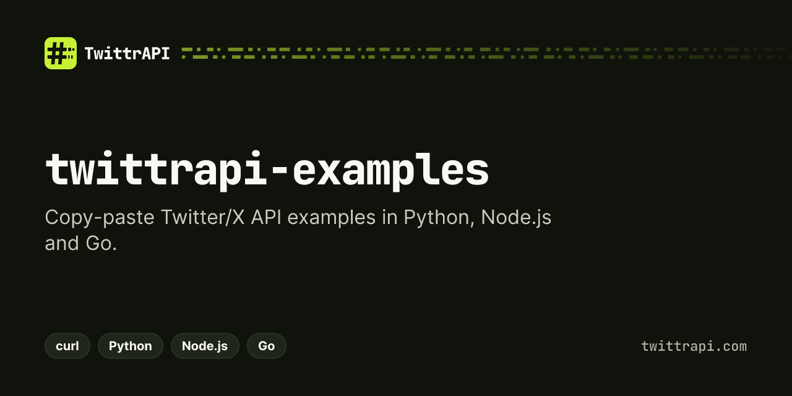

<p align="center">
  <a href="https://twittrapi.com"></a>
</p>

# TwittrAPI examples – Twitter/X API code samples in Python, Node.js and Go

[](LICENSE)

Copy-paste examples for [TwittrAPI](https://twittrapi.com/?utm_source=github&utm_medium=readme&utm_campaign=examples), a read API for Twitter/X data: profiles, tweets, followers, search, lists, communities and trends. Each folder solves one common task, such as exporting followers to CSV, monitoring a keyword in Slack or getting trends by country, and has its own README with the command to run and sample output.

> **Get an API key:** [twittrapi.com/start](https://twittrapi.com/start?utm_source=github&utm_medium=readme&utm_campaign=twittrapi-examples) · [Pricing](https://twittrapi.com/pricing?utm_source=github&utm_medium=readme&utm_campaign=twittrapi-examples) · [Docs](https://twittrapi.com/docs?utm_source=github&utm_medium=readme&utm_campaign=twittrapi-examples) · [Status](https://twittrapi.com/status) · also available on [RapidAPI](https://rapidapi.com/viperscores-viperscores-default/api/twitter-aio)

**SDKs and integrations:** [Python](https://github.com/twittrapi/twittrapi-python) · [Node.js](https://github.com/twittrapi/twittrapi-node) · [Go](https://github.com/twittrapi/twittrapi-go) · [MCP server](https://github.com/twittrapi/twittrapi-mcp) · [n8n](https://github.com/twittrapi/n8n-nodes-twittrapi) · [Make](https://github.com/twittrapi/twittrapi-make) · [Apify](https://github.com/twittrapi/twittrapi-apify) · [LangChain](https://github.com/twittrapi/langchain-twittrapi) · [LlamaIndex](https://github.com/twittrapi/llama-index-tools-twittrapi) · [Agent skill](https://github.com/twittrapi/twittrapi-skills)

> **Note:** the official SDKs ([`twittrapi` on PyPI](https://github.com/twittrapi/twittrapi-python), [`twittrapi` on npm](https://github.com/twittrapi/twittrapi-node), [`twittrapi-go`](https://github.com/twittrapi/twittrapi-go)) are being published. Until they are live, `pip install`, `npm install` and `go get` for them may fail; the curl examples work today.

## Examples

| Example | Language | What it does |
| --- | --- | --- |
| [Export Twitter followers to CSV with Python](python/export-twitter-followers-to-csv) | Python | Save any account's followers (ID, handle, name, counts, bio) to a CSV file. |
| [Get tweets from a Twitter user with Python](python/get-tweets-from-user) | Python | Print a user's latest tweets with likes, retweets and links. |
| [Download tweets to JSON with Python](python/download-tweets-to-json) | Python | Save search results or a user's timeline as a JSON file (flat or raw). |
| [Twitter followers count tracker in Python](python/twitter-followers-count-tracker) | Python | Log follower counts for several accounts to a CSV history and show daily change. |
| [Send tweets to Google Sheets with Python](python/tweets-to-google-sheets) | Python | Append tweets matching a search to a Google Sheet, skipping duplicates. |
| [Export Twitter list members to CSV with Python](python/export-twitter-list-members) | Python | Save every member of an X list to CSV. |
| [Monitor a Twitter keyword and send new tweets to Slack (Node.js)](node/monitor-twitter-keyword-and-send-to-slack) | Node.js | Poll X search for a keyword and post new tweets to a Slack webhook. |
| [Scrape Twitter search results with Node.js](node/scrape-twitter-search-results) | Node.js | Save X search results (Top, Latest, Photos, Videos) to CSV or JSON. |
| [Find tweets mentioning a brand (Node.js)](node/find-tweets-mentioning-a-brand) | Node.js | Find mentions of a brand name or @handle, ranked by engagement. |
| [Twitter user lookup by username (Node.js)](node/twitter-user-lookup-by-username) | Node.js | Get a user's ID, name, follower counts, bio and join date from a username. |
| [Export Twitter Community tweets (Node.js)](node/export-twitter-community-tweets) | Node.js | Find X Communities by keyword and export their tweets to JSONL or CSV. |
| [Get Twitter trending topics by country (Go)](go/get-trending-topics-by-country) | Go | Print current X trends for a country code, city name or worldwide. |
| [Track competitor tweets (Go)](go/track-competitor-tweets) | Go | Report new tweets from a set of accounts since the last run, with engagement. |
| [Get replies to a tweet (Go)](go/get-replies-to-a-tweet) | Go | Fetch a tweet's replies, sorted by relevance, recency or likes, and save them as JSON. |
| [Export who retweeted a tweet to CSV (Go)](go/export-tweet-retweeters-to-csv) | Go | Save the accounts that retweeted a tweet (or its quote tweets) to CSV. |
| [Get a Twitter user ID from a username with curl](shell/get-twitter-user-id-from-username) | Shell | Convert usernames to numeric X user IDs with curl and jq. |
| [Search tweets with curl](shell/search-tweets-with-curl) | Shell | Run an X search from the command line and get one JSON object per tweet. |
| [Get Twitter trends with curl](shell/get-twitter-trends-with-curl) | Shell | Fetch trending topics by WOEID with curl and jq. |

## Quickstart

1. Get an API key at [twittrapi.com/start](https://twittrapi.com/start?utm_source=github&utm_medium=readme&utm_campaign=examples) (or subscribe on [RapidAPI](https://rapidapi.com/viperscores-viperscores-default/api/twitter-aio)).
2. Put it in an environment variable. Every example reads `TWITTRAPI_API_KEY` first, then `RAPIDAPI_KEY`:

   ```bash
   export TWITTRAPI_API_KEY=your_key
   # or
   export RAPIDAPI_KEY=your_rapidapi_key
   ```

3. Run an example:

   ```bash
   git clone https://github.com/twittrapi/twittrapi-examples.git
   cd twittrapi-examples

   # Python
   pip install twittrapi
   python python/export-twitter-followers-to-csv/export_followers.py jack followers.csv

   # Node.js 18+
   cd node && npm install && node twitter-user-lookup-by-username/lookup.mjs jack && cd ..

   # Go 1.21+
   cd go && go run ./get-trending-topics-by-country US && cd ..

   # curl + jq
   ./shell/search-tweets-with-curl/search.sh "openai lang:en"
   ```

Keys are only read from the environment. Never commit them; `.env` and Google `service-account*.json` files are in `.gitignore`.

## How the examples are built

- The SDKs return X's raw GraphQL JSON unchanged. Each language folder has one small parser that pulls users, tweets and trends out of it: [`python/_shared/extract.py`](python/_shared/extract.py), [`node/_shared/extract.mjs`](node/_shared/extract.mjs), [`go/internal/extract`](go/internal/extract) and the `jq` filters in [`shell/_shared/twittrapi.sh`](shell/_shared/twittrapi.sh). The response shapes come from X and can change, so the parsers search the whole response instead of following one fixed path.
- Paginated calls cost one request per page. The examples cap the number of pages with a flag (`--max-pages`, `--pages` or `-pages`).
- Failed requests with 429, 5xx or network errors are retried by the SDKs with backoff.

## Testing the examples offline

[`tools/`](tools) has a small mock server with fake fixture data, so the examples can be checked without an API key or network access:

```bash
tools/setup-local-sdks.sh   # venv + local SDK links (needs the SDK repos next to this one)
tools/verify.sh             # py_compile/imports, node --check + checkJs, go vet/build, bash -n
tools/e2e.sh                # runs 21 example commands against tools/mock_server.py
```

## Support

Questions or a missing example: open an issue or email support@twittrapi.com. API docs: [twittrapi.com/docs](https://twittrapi.com/docs?utm_source=github&utm_medium=readme&utm_campaign=examples).

## License

[MIT](LICENSE).

Not affiliated with X Corp. "Twitter" and "X" are trademarks of X Corp.
